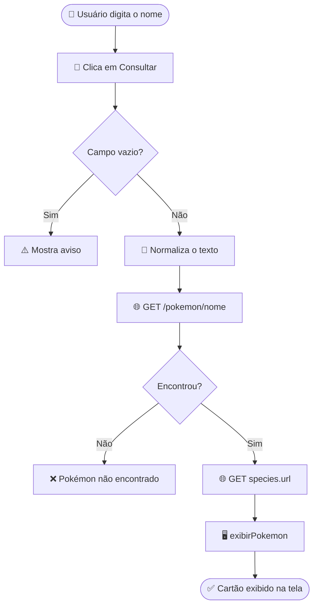

<div align="center">


# ⚡ Pokédex ⚡

### Pesquise um Pokémon e descubra tudo sobre ele!


[✨ Funcionalidades](#-funcionalidades) •
[📁 Estrutura](#-estrutura-do-projeto) •
[🚀 Como executar](#-como-executar) •
[🧠 Como funciona](#-como-funciona) •
[🎨 Visual](#-visual)

</div>

---

## 🔴 Sobre o projeto

A **Pokédex** é uma aplicação web que consulta a [PokeAPI](https://pokeapi.co), recebe os dados em **JSON**, processa e mostra tudo sobre um Pokémon de forma **dinâmica**. Basta digitar o nome, clicar em **Consultar** e a página exibe imagem, tipos, atributos, habilidades e muito mais, **sem recarregar**.

Feita com **HTML, CSS e JavaScript puros**: sem frameworks e sem precisar de servidor. 🎉

> [!TIP]
> Quer testar rápido? Abra o `index.html`, digite `pikachu` e clique em **Consultar**.

---

## ✨ Funcionalidades

| | Recurso |
| :-: | --- |
| 🔍 | Pesquisa por **nome** (ou número) do Pokémon |
| 🌐 | Consulta à API pública com `fetch` e `async/await` |
| 🖼️ | Arte oficial e descrição da Pokédex |
| 🏷️ | Tipos traduzidos para português, com a cor de cada tipo |
| 📏 | Altura, peso e experiência base já convertidos |
| 💪 | Habilidades, com destaque para a **habilidade oculta** |
| 📊 | Atributos base em **barras animadas** e total somado |
| 🥚 | Habitat e grupos de ovos |
| 👾 | Sprites de frente, costas e versões **shiny** |
| ⚔️ | Amostra de golpes e total de golpes aprendidos |
| 🎨 | Cartão que muda de cor conforme o **tipo principal** |
| 🛡️ | Tratamento de erros (campo vazio, Pokémon inexistente, falha de conexão) |
| 📱 | Layout responsivo para celular, tablet e computador |

---

## 📁 Estrutura do projeto

```
📦 pw1-pokedex
 ┣ 📜 index.html    →  estrutura da página (formulário e área de resultados)
 ┣ 🎨 style.css     →  tema visual estilo Pokédex
 ┣ ⚙️ script.js     →  consulta à API e atualização da tela
 ┗ 📖 README.md     →  você está aqui!
```

---

## 🚀 Como executar

**1️⃣** Baixe a pasta do projeto

**2️⃣** Abra o arquivo `index.html` no navegador (clique duas vezes ou use a extensão *Live Server* do VS Code)

**3️⃣** Digite o nome de um Pokémon **em inglês** e clique em **Consultar**

<div align="center">

| ⚡ Elétrico | 🔥 Fogo | 🌿 Planta | 👻 Fantasma | 🐉 Dragão |
| :-: | :-: | :-: | :-: | :-: |
| `pikachu` | `charizard` | `bulbasaur` | `gengar` | `dragonite` |

</div>

> [!NOTE]
> É necessária conexão com a internet, pois os dados vêm da API e as fontes vêm do Google Fonts.

---

## 🧠 Como funciona



### 🧹 Normalização da busca

Antes de consultar a API, o texto digitado passa por um tratamento:

| ⌨️ Digitado | 📤 Enviado à API |
| --- | --- |
| ` Pikachu ` | `pikachu` |
| `Mr. Mime` | `mr-mime` |
| `mr mime` | `mr-mime` |

### 🌐 Requisições feitas

| # | Requisição | Endereço | Dados utilizados |
| :-: | --- | --- | --- |
| 1️⃣ | **Pokémon** | `https://pokeapi.co/api/v2/pokemon/{nome}` | `id`, `name`, `types`, `height`, `weight`, `base_experience`, `abilities`, `stats`, `sprites`, `moves` |
| 2️⃣ | **Espécie** | endereço em `species.url` do JSON anterior | `flavor_text_entries`, `genera`, `habitat`, `egg_groups` |

<details>
<summary>⚙️ <b>Principais funções do <code>script.js</code></b> (clique para abrir)</summary>

<br>

| Função | O que faz |
| --- | --- |
| `consultarPokemon()` | Lê o campo, valida, faz as requisições e trata erros |
| `exibirPokemon(dados, especie)` | Escreve todas as informações na página |
| `mostrarMensagem(texto)` | Exibe avisos e erros e esconde o resultado anterior |
| `formatarNome(nome)` | Transforma `mr-mime` em `Mr Mime` |

</details>

<details>
<summary>🔢 <b>Conversões aplicadas</b> (clique para abrir)</summary>

<br>

- 📏 **Altura:** a API retorna em decímetros, e o valor é dividido por 10 para exibir em metros
- ⚖️ **Peso:** a API retorna em hectogramas, e o valor é dividido por 10 para exibir em quilogramas
- 📊 **Barras de atributos:** largura proporcional ao valor base (referência de 200 = 100%)
- 🌎 **Tipos e atributos:** nomes traduzidos para português por objetos de tradução no início do script

</details>

---

## 🛡️ Tratamento de erros

| Situação | O que acontece |
| --- | --- |
| 📝 Campo vazio | Aviso pedindo para digitar um nome |
| 🔎 Pokémon não encontrado (erro 404) | Mensagem orientando a conferir o nome em inglês |
| 📡 Falha de rede ou da API | Mensagem genérica, e o erro detalhado vai para o `console` do navegador |
| 🧩 Falha só na consulta da espécie | A página mostra o restante das informações normalmente |

---

## 🎨 Visual

- 🔴 Topo inspirado em um aparelho Pokédex, com **lente azul e luzes**, feito só com CSS
- 🌈 Cartão que muda de cor conforme o tipo principal, usando variáveis CSS (`--cor`)
- 📶 Barras de atributos animadas (respeitando a preferência de movimento reduzido do sistema)
- 🔤 Fontes **Fredoka** (títulos) e **Nunito** (textos)

<div align="center">

| Tipo | Cor | Tipo | Cor | Tipo | Cor |
| :-: | :-: | :-: | :-: | :-: | :-: |
| 🔥 Fogo |  | 💧 Água |  | 🌿 Planta |  |
| ⚡ Elétrico |  | ❄️ Gelo |  | 👻 Fantasma |  |
| 🧚 Fada |  | 🐉 Dragão |  | 🔮 Psíquico |  |

</div>

---

## 📌 Observações

> [!IMPORTANT]
> Digite os nomes dos Pokémon **em inglês**, pois é assim que a API os registra.

- 🇺🇸 As descrições e categorias aparecem em inglês, porque a PokeAPI não oferece esses textos em português para a maioria dos Pokémon
- 🆓 A PokeAPI é gratuita e **não exige chave** de acesso

---

## 🛠️ Tecnologias


- **HTML5**: estrutura semântica
- **CSS3**: variáveis, grid, flexbox e `color-mix`
- **JavaScript**: `async/await`, `fetch`, arrow functions e template strings

---

<div align="center">

### 💛 Créditos

Dados e imagens fornecidos pela [PokeAPI](https://pokeapi.co)

<sub>Pokémon e seus nomes são marcas registradas da Nintendo, Game Freak e The Pokémon Company.<br>Este projeto tem finalidade apenas educacional.</sub>

<br>

**Gotta code 'em all!** ⚡🔴⚪

</div>
